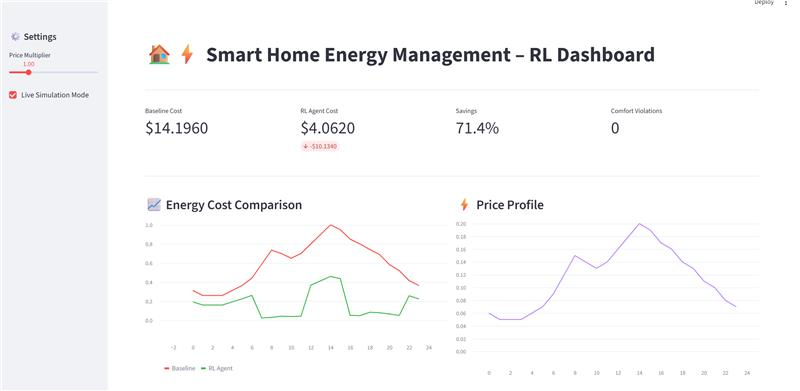
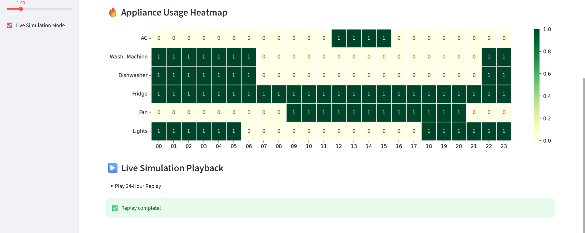
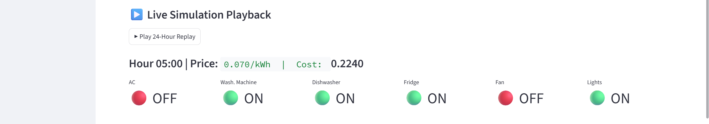

# Smart Home Energy Optimization with DQN

A reinforcement learning project that schedules household appliances under a simulated time-of-use electricity tariff. A custom Gymnasium environment and Stable-Baselines3 Deep Q-Network (DQN) balance electricity cost, comfort, peak usage, and appliance switching. A Streamlit dashboard presents the daily schedule and cost comparison.

## Dashboard preview





## Recorded notebook results

These values come from the saved evaluation output in [the notebook](smart_home_rl_energy.ipynb), evaluated over one simulated 24-hour day. They are not measurements from a real household or a fresh run.

| Metric | Recorded value |
| --- | ---: |
| Always-on baseline daily cost | $14.1960 |
| DQN daily cost | $4.0620 |
| Absolute savings | $10.1340 |
| Savings against always-on baseline | 71.4% |
| Comfort violations | 0 |
| Average appliance switches per hour | 0.33 |

The baseline keeps AC, washing machine, and dishwasher on all day; fridge, fan, and lights retain their fixed schedules. This deliberately simple baseline makes the savings unsuitable as a claim about typical household bills.

## Features

- Eight discrete ON/OFF combinations for three controlled appliances.
- A 24-step daily environment with hourly electricity prices.
- Reward shaping for cost, AC comfort, peak demand, switching, and appliance use.
- Notebook training curves, cost comparisons, usage heatmaps, replay animation, and scenario widgets.
- Streamlit price multiplier, cost metrics, appliance heatmap, and 24-hour replay.
- Self-contained simulation: no external dataset, API key, or pretrained model is required.

## Quick start

Use Python 3.11 in a virtual environment.

```bash
git clone https://github.com/maishashwathu/Home-energy-optimization.git
cd Home-energy-optimization
python -m venv .venv
```

Activate it on Windows PowerShell:

```powershell
.\.venv\Scripts\Activate.ps1
```

Or on macOS/Linux:

```bash
source .venv/bin/activate
```

Install and start the dashboard:

```bash
python -m pip install --upgrade pip
python -m pip install -r requirements.txt
python -m streamlit run dashboard.py
```

Open the local URL printed by Streamlit. The first dashboard load trains a DQN for **100,000 timesteps**, which can take several minutes depending on hardware. The model is cached in the running Streamlit process; restarting the process trains it again. No model checkpoint is currently loaded or saved by the dashboard.

### Run the notebook

```bash
python -m pip install -r requirements-notebook.txt
python -m jupyter lab smart_home_rl_energy.ipynb
```

Select the environment's Python kernel and run cells in order. Notebook training also uses **100,000 timesteps** (the earlier markdown hyperparameter table says 30,000; executable code is authoritative). It writes logs and figures to hardcoded `/tmp/` paths; on Windows, replace these with a writable local output directory and create it before running.

## Environment design

| Appliance | Power (kW) | Control |
| --- | ---: | --- |
| AC | 2.0 | DQN |
| Washing machine | 1.5 | DQN |
| Dishwasher | 1.2 | DQN |
| Fridge | 0.2 | Always on |
| Fan | 0.1 | 09:00–20:59 |
| Lights | 0.3 | 18:00–05:59 |

The observation contains normalized hour, normalized price, and six appliance states. Action bits encode AC, washing machine, and dishwasher, respectively; action 7 turns all three on.

For each one-hour step, electricity cost is total power in kW multiplied by price per kWh. Reward is negative cost, minus comfort, peak, switching, and end-of-day penalties, plus an off-peak appliance bonus.

| Reward component | Implemented rule |
| --- | --- |
| Comfort | 0.5 penalty if AC is off from 12:00 to 15:59 |
| Peak | 0.3 penalty when price > 0.15 and both AC and washing machine are on |
| Switching | 0.05 penalty per controlled appliance toggle |
| Off-peak | 0.25 bonus for each of washing machine and dishwasher on when price ≤ 0.09 |
| Task completion | At hour 23, 1.0 penalty for each of washing machine and dishwasher never used that day |

## Training configuration

The notebook uses DQN with `MlpPolicy`, learning rate 0.001, replay buffer 50,000, learning starts 500, batch size 64, gamma 0.99, training frequency 4, target update interval 250, and seed 42. Exploration decreases from 1.0 to 0.05 over the first 30% of training. Saved output reports 4,166 completed episodes.

The dashboard sets learning rate, replay buffer, and seed explicitly, but otherwise uses library defaults. Its independently trained policy can therefore differ from the notebook results.

## Repository guide

| File | Purpose |
| --- | --- |
| `smart_home_rl_energy.ipynb` | Environment, training, evaluation, visualizations, and interactive scenarios |
| `dashboard.py` | Standalone Streamlit application with its own environment and training |
| `Dashboard_SS1.png`–`Dashboard_SS3.png` | Existing dashboard screenshots |
| `requirements.txt` | Dashboard and simulation dependencies |
| `requirements-notebook.txt` | Adds Jupyter and notebook widgets |
| `docs/RESULTS.md` | Evaluation provenance and interpretation |
| `.gitignore` | Excludes local environments, caches, logs, and model checkpoints |

## Limitations and next steps

This is an educational simulation with a fixed synthetic tariff and binary appliance control. AC comfort is an hour-based proxy; the notebook temperature plot is illustrative and is not used in the environment dynamics. Washing and dishwasher operation has no cycle-duration or exactly-once constraint, and repeated off-peak bonuses can encourage prolonged operation. Completion flags are internal state and are absent from observations.

Uniform price scaling is canceled by price normalization, so the trained policy sees essentially the same observations at different dashboard multipliers. The dashboard re-evaluates the existing policy and does not retrain it for changed prices.

The notebook scenario comfort override adds penalties without removing the original window and can double-count overlapping violations. Its comprehensive dashboard also plots a constant all-six-on baseline power, while the actual baseline keeps fan and lights scheduled. See [results notes](docs/RESULTS.md) before interpreting plots.

Useful extensions include a shared environment module, realistic appliance cycles, temperature dynamics, multiple tariff profiles, a scheduled rule-based comparator, evaluation across seeds, and saved model loading.
